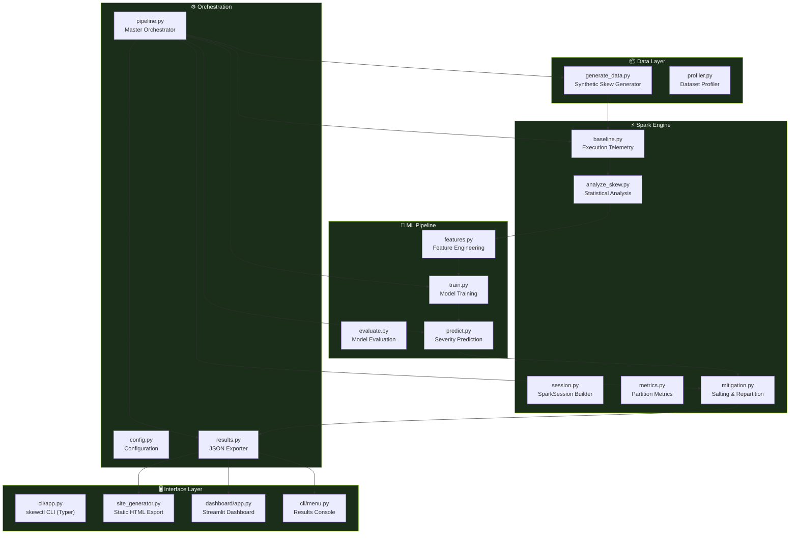

<div align="center">

# ⚡ Data Skew Intelligence Engine

**Intelligent Data Skew Detection & Mitigation in Apache Spark**

*ML-Powered Severity Classification • Automated Salting & Repartitioning • Real-Time Partition Telemetry*

[](https://python.org)
[](https://spark.apache.org)
[](https://scikit-learn.org)
[](https://streamlit.io)
[](https://docker.com)

[](https://github.com/SanyogSingh07/data-skew-intelligence/actions/workflows/ci.yml)
[](https://github.com/SanyogSingh07/data-skew-intelligence/actions/workflows/pages.yml)
[](LICENSE)
[](#-testing--verification)
[](https://docs.astral.sh/ruff/)

---

**Project ID:** `23BTRDC034` &nbsp;•&nbsp; **Course:** Data Engineering / Big Data Analytics with Apache Spark

</div>

---

## 📋 Table of Contents

- [Overview](#-overview)
- [Key Features](#-key-features)
- [Architecture](#-architecture)
- [Quick Start](#-quick-start)
- [CLI Reference](#-cli-reference-skewctl)
- [Pipeline Execution](#-pipeline-execution)
- [Results Console](#-interactive-results-console)
- [Visualization Gallery](#-visualization-gallery)
- [ML Pipeline](#-ml-classification-pipeline)
- [Streamlit Dashboard](#-streamlit-dashboard)
- [Docker Deployment](#-docker-deployment)
- [CI/CD Pipelines](#-cicd-pipelines)
- [Testing & Verification](#-testing--verification)
- [Repository Structure](#-repository-structure)
- [Technical Documentation](#-technical-documentation)
- [Roadmap](#-roadmap)
- [Contributing](#-contributing)
- [License](#-license)

---

## 🔍 Overview

**Data Skew Intelligence** is a production-grade analytics engine that measures how data key concentration impacts distributed execution in Apache Spark, uses machine learning classifiers to predict skew severity (`NORMAL`, `LOW_SKEW`, `HIGH_SKEW`), and applies automated mitigation strategies to eliminate straggler tasks and optimize partition balance.

```
                    ┌───────────────────────────────┐
                    │   Synthetic Skewed Dataset     │
                    │   (Controlled Key Frequency)   │
                    └──────────────┬────────────────┘
                                   │
                    ┌──────────────▼────────────────┐
                    │  Spark Telemetry Collection    │
                    │  Partition Stats • Shuffle I/O │
                    └──────────────┬────────────────┘
                                   │
                    ┌──────────────▼────────────────┐
                    │  Statistical Skew Analysis     │
                    │  Z-Score • CV • SkewScore      │
                    └──────────────┬────────────────┘
                                   │
                    ┌──────────────▼────────────────┐
                    │  ML Severity Classifier        │
                    │  LR • DT • Random Forest       │
                    └──────────────┬────────────────┘
                                   │
                    ┌──────────────▼────────────────┐
                    │  Mitigation Recommendation     │
                    │  NONE • REPARTITION • SALTING  │
                    └──────────────┬────────────────┘
                                   │
                    ┌──────────────▼────────────────┐
                    │  Before/After Comparison       │
                    │  Charts • Reports • Dashboard  │
                    └───────────────────────────────┘
```

---

## ✨ Key Features

| Feature | Description |
|:--------|:------------|
| 🔬 **Controlled Skew Generation** | Synthetic dataset generator with configurable key skew ratios (10%–90%) |
| 📊 **Partition Telemetry** | Physical partition statistics, shuffle I/O metrics, CV and skew ratio tracking |
| 🤖 **ML Severity Classifier** | Logistic Regression, Decision Tree, Random Forest — auto-selects best by F1 |
| ⚡ **Automated Mitigation** | Two-phase Salted Aggregation for HIGH_SKEW, Shuffle Repartitioning for LOW_SKEW |
| 📈 **NVIDIA-Themed Charts** | 6 publication-quality dark-theme visualizations with Matplotlib |
| 🖥️ **Rich Terminal Console** | 9-option interactive Results Console with Rich tables and panels |
| 🌐 **Streamlit Dashboard** | Interactive web UI with Plotly charts and ML diagnostics |
| 🐳 **Docker Ready** | One-command containerized deployment with Docker Compose |
| 🔄 **CI/CD Pipelines** | GitHub Actions for testing, benchmarking, and GitHub Pages deployment |
| 📄 **Static Site Export** | Self-contained HTML/CSS/JS dashboard for GitHub Pages hosting |
| 🧪 **Comprehensive Tests** | 33 unit & integration tests with pytest + coverage |

---

## 🏗️ Architecture



---

## 🚀 Quick Start

### Prerequisites

| Requirement | Version |
|:------------|:--------|
| Python | 3.11+ |
| Java JDK | 17+ (Temurin recommended) |
| pip | Latest |

### Installation

```bash
# Clone the repository
git clone https://github.com/SanyogSingh07/data-skew-intelligence.git
cd data-skew-intelligence

# Create virtual environment
python -m venv .venv

# Activate (Windows)
.venv\Scripts\activate

# Activate (macOS/Linux)
source .venv/bin/activate

# Install dependencies
pip install -r requirements.txt
```

### One-Click Execution

```bash
# Windows — double-click or run from terminal
run.bat

# Standard execution (runs full pipeline + interactive results console)
python run.py

# Quick mode with 10,000 rows
python run.py --quick

# Verify environment readiness
python run.py --check

# Launch Streamlit dashboard after execution
python run.py --dashboard

# Clean old artifacts and run fresh
python run.py --clean

# Non-interactive mode (CI/automation)
python run.py --no-menu

# Export static HTML site for GitHub Pages
python run.py --export-site
```

---

## 🛠️ CLI Reference (`skewctl`)

Full CLI powered by **Typer** + **Rich** for granular control:

```bash
# System readiness check
python -m cli.app system check

# Generate datasets with controlled skew
python -m cli.app data generate --rows 100000 --skew 0.70
python -m cli.app data inspect --input data/generated/skew_70.parquet

# Spark execution & analysis
python -m cli.app spark baseline --input data/generated/skew_70.parquet
python -m cli.app spark analyze --input data/generated/skew_70.parquet

# ML model training & prediction
python -m cli.app ml build-dataset
python -m cli.app ml train
python -m cli.app ml evaluate
python -m cli.app ml predict --input data/generated/skew_70.parquet

# Mitigation strategies
python -m cli.app mitigate repartition --input data/generated/skew_70.parquet
python -m cli.app mitigate salt --input data/generated/skew_70.parquet
python -m cli.app mitigate auto --input data/generated/skew_70.parquet

# End-to-end experiments
python -m cli.app experiment run --rows 100000 --skew 0.90 --mitigation auto
python -m cli.app experiment compare

# Streamlit dashboard
python -m cli.app dashboard launch --port 8501
```

---

## ⚡ Pipeline Execution

The 9-step master pipeline runs end-to-end with a single command:

<div align="center">


</div>

| Step | Phase | Description |
|:----:|:------|:------------|
| 1/9 | **Environment** | Validates Java JDK 17+, PySpark, scikit-learn |
| 2/9 | **Dataset** | Generates synthetic controlled-skew data |
| 3/9 | **EDA / Skew Analysis** | Key frequency stats, Z-score, SkewScore |
| 4/9 | **Spark Baseline** | GroupBy execution telemetry collection |
| 5/9 | **ML Model Training** | Trains 3 classifiers, selects best by F1 |
| 6/9 | **Detection & Severity** | ML prediction → mitigation recommendation |
| 7/9 | **Mitigation Execution** | Applies Salting or Repartitioning |
| 8/9 | **Automated Tests** | Runs pytest unit & integration suite |
| 9/9 | **Results Export** | JSON metrics, PNG charts, CSV data |

---

## 🖥️ Interactive Results Console

After pipeline execution, the interactive **Results Console** provides 9 navigation options:

<div align="center">


</div>

| Option | View |
|:------:|:-----|
| 1 | Latest Experiment Summary |
| 2 | Experiment History |
| 3 | Dataset Profile & Top Keys Distribution |
| 4 | Spark Execution Telemetry (Baseline vs Mitigated) |
| 5 | Before vs After Performance Comparison |
| 6 | ML Classifier Diagnostics (Accuracy, Precision, Recall, F1) |
| 7 | View Generated PNG Charts |
| 8 | Run Pipeline Again |
| 9 | Exit Console |

---

## 📊 Visualization Gallery

All charts use an **NVIDIA-inspired engineering dark theme** (`#0B0F0C` background, `#76B900` green accent).

### Key Distribution — Hot Key Concentration

Shows the extreme imbalance: `KEY_00000` holds **94.2%** (7,000/10,000) of all records.


### Physical Partition Record Distribution

Partition P5 is a straggler with **7,394 records** vs a mean of 1,250 — a 5.9x imbalance.


### Before vs After Partition Balance

Salting spreads the hot key across all 8 partitions, reducing max partition from **7,394 → 2,090**.


### Performance Comparison — Runtime & Max Partition

Side-by-side runtime and partition size reduction after mitigation.


### Skew Percentage vs Execution Time

Execution time increases linearly with key skew concentration.


### Skew Percentage vs Partition CV

Partition Coefficient of Variation grows proportionally with key skew.


---

## 🤖 ML Classification Pipeline

### Three-Model Tournament

The engine trains three classifiers in increasing complexity and selects the best by **macro F1-score**:

| Model | Algorithm | Key Parameters |
|:------|:----------|:---------------|
| **Logistic Regression** | Linear classifier with StandardScaler | `max_iter=1000` |
| **Decision Tree** | Axis-aligned splits | `max_depth=6` |
| **Random Forest** | Ensemble of 200 trees | `n_estimators=200, max_depth=10` |

### Feature Engineering

The classifier uses 9 engineered features from Spark telemetry:

| Feature | Source |
|:--------|:-------|
| `skew_ratio` | Max partition / mean partition |
| `coefficient_of_variation` | Std / mean of partition sizes |
| `max_partition_size` | Largest physical partition |
| `mean_partition_size` | Average partition records |
| `partition_std` | Standard deviation of partition records |
| `execution_time_sec` | Wall-clock Spark job time |
| `top1_concentration` | Fraction of records in hottest key |
| `top5_concentration` | Fraction of records in top-5 keys |
| `shuffle_read_bytes` | Spark shuffle read I/O |

### Decision Engine

```
Severity = NORMAL    →  Mitigation = NONE
Severity = LOW_SKEW  →  Mitigation = REPARTITION (2× shuffle partitions)
Severity = HIGH_SKEW →  Mitigation = SALTING (8 salt buckets, 2-phase aggregation)
```

---

## 🌐 Streamlit Dashboard

Interactive web dashboard with 3 tabs:

| Tab | Content |
|:----|:--------|
| **Experiments Benchmark** | Experiment comparison table + Plotly before/after charts |
| **Persisted Data & Distributions** | Key frequency & partition distribution with interactive plots |
| **ML Model Diagnostics** | Classifier accuracy, precision, recall, F1 comparison bars |

```bash
# Launch standalone
python run.py --dashboard

# Or via CLI
python -m cli.app dashboard launch --port 8501
```

Access at **[http://localhost:8501](http://localhost:8501)**

---

## 🐳 Docker Deployment

### Docker Compose (Recommended)

```bash
# Build and run
docker compose up --build

# Access Streamlit Dashboard
# → http://localhost:8501

# Access Spark UI (when running)
# → http://localhost:4040
```

### Standalone Docker

```bash
# Build image
docker build -t data-skew-intelligence .

# Run system check
docker run --rm data-skew-intelligence

# Run pipeline
docker run --rm data-skew-intelligence python run.py --quick --no-menu

# Launch dashboard
docker run --rm -p 8501:8501 data-skew-intelligence \
  python -m streamlit run dashboard/app.py --server.port=8501 --server.address=0.0.0.0
```

---

## 🔄 CI/CD Pipelines

Three GitHub Actions workflows automate testing, benchmarking, and deployment:

### CI (`ci.yml`)

Triggers on every push/PR to `main`:

| Step | Action |
|:-----|:-------|
| Environment | Python 3.11 + Java 17 (Temurin) |
| Dependencies | `pip install -r requirements.txt` + dev deps |
| Readiness Check | `python run.py --check` |
| Syntax Check | `python -m compileall .` |
| Lint | `ruff check .` |
| Tests | `pytest -q --cov=. --cov-report=term-missing` |
| Smoke Test | `python run.py --quick --no-menu --export-site` |

### Benchmark (`benchmark.yml`)

Manual dispatch workflow for running custom experiments:

```bash
# Trigger via GitHub UI with custom parameters:
# rows: 100000, skew: 0.90
```

### GitHub Pages (`pages.yml`)

Auto-deploys a static results dashboard on every push to `main`:
- Runs quick pipeline + exports static site
- Deploys `site/` directory to GitHub Pages

---

## 🧪 Testing & Verification

**33 unit & integration tests** covering all modules:

```bash
# Run full suite
pytest

# With coverage report
pytest -q --cov=. --cov-report=term-missing

# Run specific module tests
pytest tests/test_data.py          # Data generation
pytest tests/test_spark.py         # Spark session & config
pytest tests/test_ml.py            # ML training & prediction
pytest tests/test_mitigation.py    # Salting & repartition
pytest tests/test_cli.py           # CLI commands
pytest tests/test_smoke.py         # End-to-end smoke tests
```

| Test File | Coverage |
|:----------|:---------|
| `test_data.py` | Data generation & profiling |
| `test_data_generation.py` | Controlled skew dataset validity |
| `test_spark.py` | SparkSession lifecycle & config |
| `test_skew_analysis.py` | EDA, Z-score, SkewScore computation |
| `test_mitigation.py` | Salting & repartition correctness |
| `test_ml.py` | Model training & serialization |
| `test_ml_pipeline.py` | End-to-end ML pipeline |
| `test_cli.py` | CLI commands & argument parsing |
| `test_pipeline.py` | Master pipeline orchestrator |
| `test_site_generator.py` | Static site export |
| `test_smoke.py` | Full pipeline smoke test |

---

## 📁 Repository Structure

```
data-skew-intelligence/
├── .github/
│   └── workflows/
│       ├── ci.yml                    # CI: lint, test, smoke
│       ├── benchmark.yml             # Manual benchmark experiments
│       └── pages.yml                 # GitHub Pages deployment
├── cli/                              # Terminal application
│   ├── app.py                        # skewctl CLI (Typer + Rich)
│   ├── menu.py                       # Interactive Results Console
│   └── console.py                    # Banner & styled output
├── core/                             # Pipeline orchestration
│   ├── config.py                     # Project constants & paths
│   ├── environment.py                # Java/PySpark validator
│   ├── pipeline.py                   # 9-step master orchestrator
│   └── results.py                    # JSON metrics exporter
├── spark/                            # PySpark computation engine
│   ├── session.py                    # SparkSession builder & JVM tuning
│   ├── generate_data.py              # Synthetic skew data generator
│   ├── baseline.py                   # Spark execution telemetry
│   ├── analyze_skew.py               # EDA, Z-score, SkewScore
│   ├── metrics.py                    # Partition imbalance metrics
│   ├── mitigation.py                 # Salting & repartition algorithms
│   └── config.py                     # Spark/YAML config reader
├── ml/                               # Machine Learning engine
│   ├── features.py                   # Feature engineering & vectors
│   ├── train.py                      # 3-model training tournament
│   ├── predict.py                    # Severity prediction & recommendation
│   └── evaluate.py                   # Accuracy, precision, recall, F1
├── visualization/                    # Charts & static site
│   ├── charts.py                     # 6 Matplotlib chart generators
│   ├── theme.py                      # NVIDIA-inspired dark theme
│   ├── tables.py                     # Rich table formatters
│   ├── exporter.py                   # Data export utilities
│   ├── validators.py                 # Chart input validators
│   └── site_generator.py             # Static HTML/CSS/JS exporter
├── dashboard/                        # Streamlit web dashboard
│   └── app.py                        # Interactive 3-tab dashboard
├── data/                             # Generated datasets
│   └── generated/                    # Parquet datasets (gitignored)
├── docs/                             # Documentation & screenshots
│   ├── architecture/                 # Technical design documents
│   └── screenshots/                  # README chart images
├── tests/                            # Pytest suite (33 tests)
├── run.py                            # Master Python entrypoint
├── run.bat                           # Windows one-click launcher
├── config.yaml                       # Global configuration
├── Dockerfile                        # Container setup
├── docker-compose.yml                # Docker Compose config
├── pyproject.toml                    # Package & tool config
├── requirements.txt                  # Production dependencies
├── requirements-dev.txt              # Dev dependencies
├── CONTRIBUTING.md                   # Contribution guidelines
└── LICENSE                           # MIT License
```

---

## 📖 Technical Documentation

Detailed architecture documents in [`docs/architecture/`](docs/architecture/):

| Document | Description |
|:---------|:------------|
| 📘 [Implementation Guide](docs/architecture/implementation.md) | Comprehensive design & data skew intelligence architecture |
| ⚡ [Single Entrypoint Runner](docs/architecture/single_entrypoint_runner.md) | Unified execution engine & CLI specification |
| 🧹 [Code Optimization](docs/architecture/code_optimization.md) | Refactoring, decluttering, and code quality improvements |
| 🔧 [Correction & Optimization](docs/architecture/correction_and_optimization.md) | Java 25 & PySpark compatibility fixes |
| 🚀 [GitHub CI/CD](docs/architecture/github_ci.md) | Automated testing workflows and deployment pipelines |

---

## 🗺️ Roadmap

Future improvements and planned features:

- [ ] **Spark 4.0 Support** — Upgrade to PySpark 4.x when GA
- [ ] **Deep Learning Classifier** — Add LSTM/Transformer for temporal skew patterns
- [ ] **Real-Time Monitoring** — Stream partition metrics to Grafana/Prometheus
- [ ] **Multi-Join Skew** — Extend mitigation to skewed joins (not just groupBy)
- [ ] **Cloud Deployment** — Terraform modules for AWS EMR / GCP Dataproc
- [ ] **Adaptive Mitigation** — Dynamic salt bucket selection based on key cardinality
- [ ] **Experiment Tracking** — MLflow integration for model versioning
- [ ] **Web API** — FastAPI REST endpoints for programmatic access
- [ ] **Multi-Dataset Support** — CSV, Delta Lake, Iceberg format support
- [ ] **GPU Acceleration** — RAPIDS cuDF for data generation and feature engineering

---

## 🤝 Contributing

Contributions are welcome! Please read our [Contributing Guidelines](CONTRIBUTING.md) before submitting a PR.

```bash
# Development setup
pip install -r requirements-dev.txt

# Run linter
ruff check .

# Run tests
pytest -q --cov=.
```

---

## 📄 License

This project is licensed under the **MIT License** — see the [LICENSE](LICENSE) file for details.

---

<div align="center">

**Built with** ❤️ **by [Sanyog Singh](https://github.com/SanyogSingh07)**

⚡ *Data Skew Intelligence Engine* — Turning straggler tasks into optimized distributed execution.

</div>
