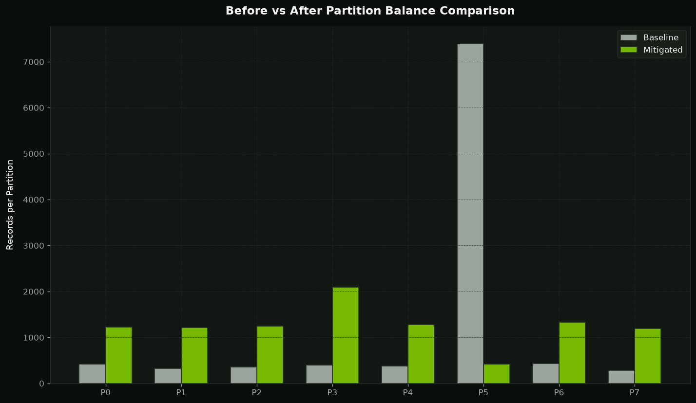
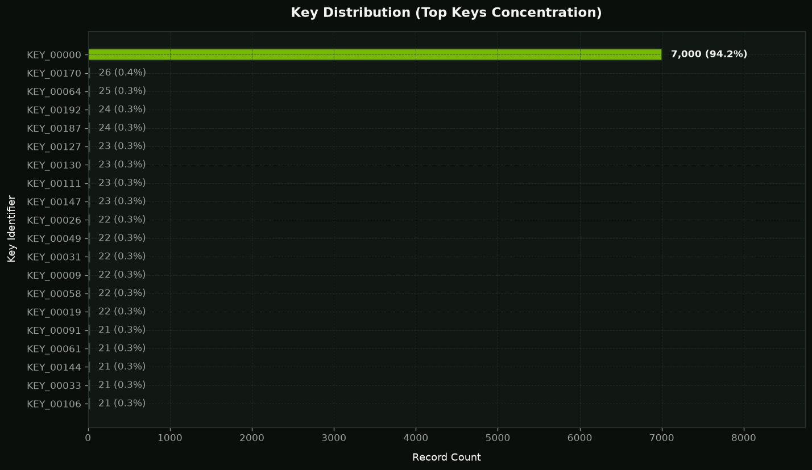
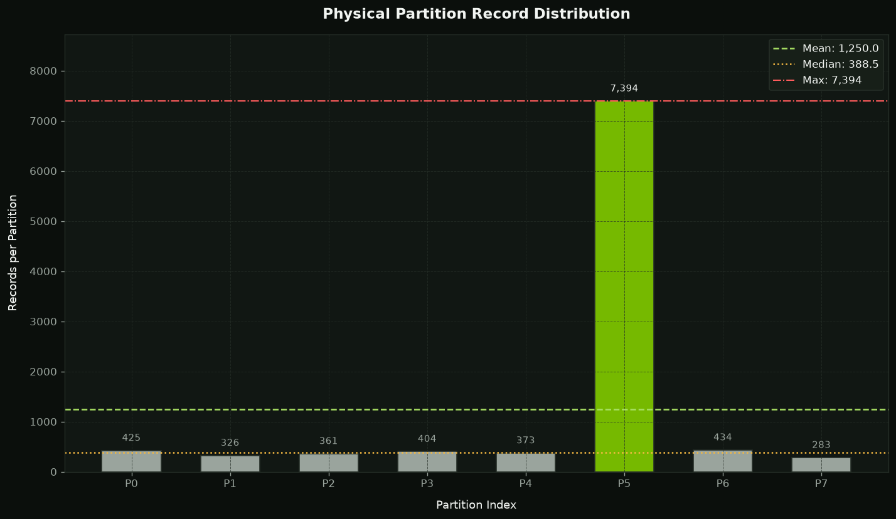
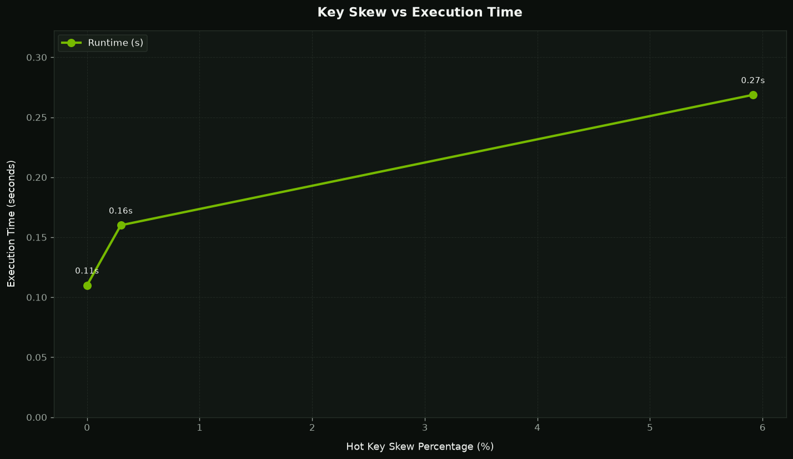
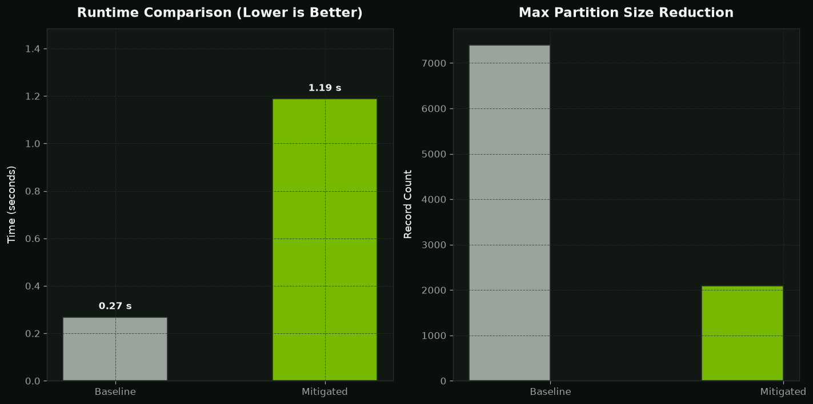
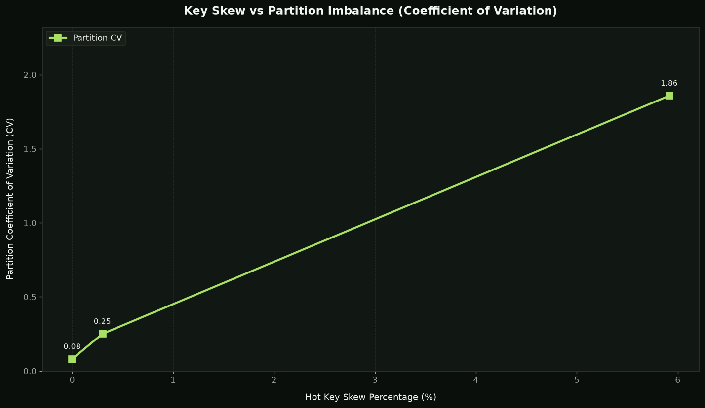
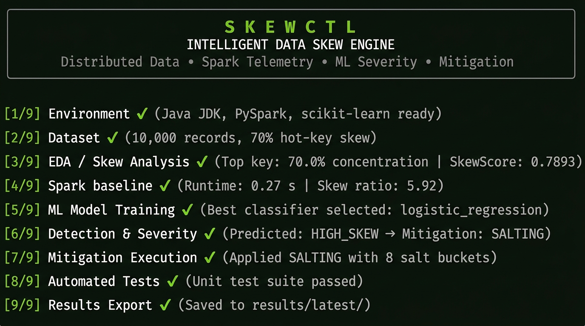
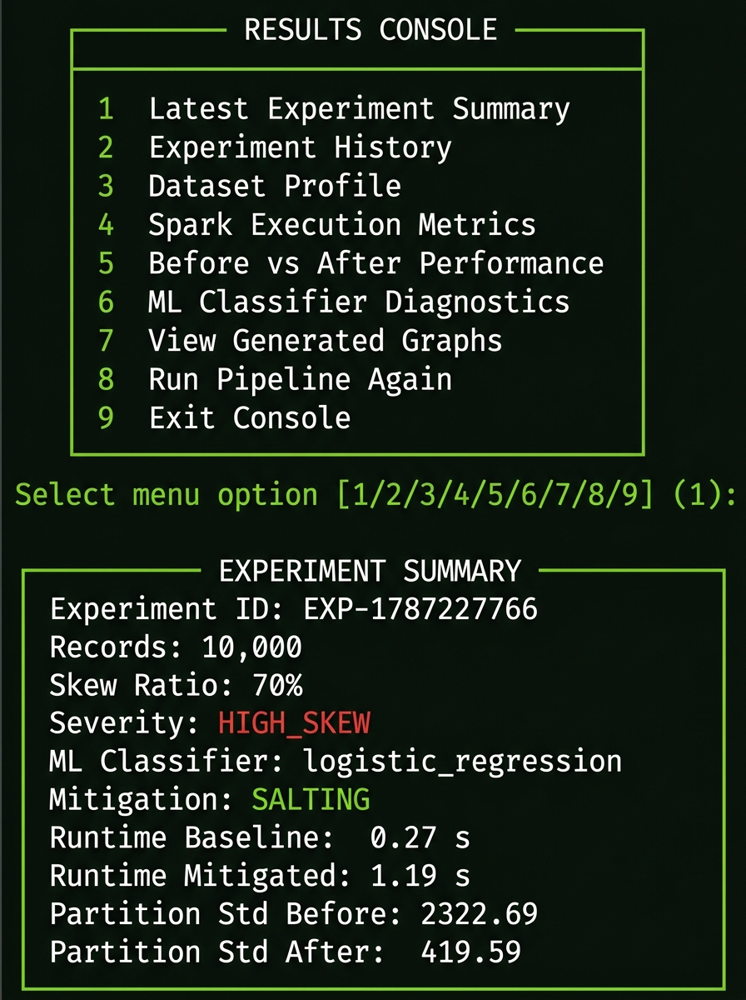
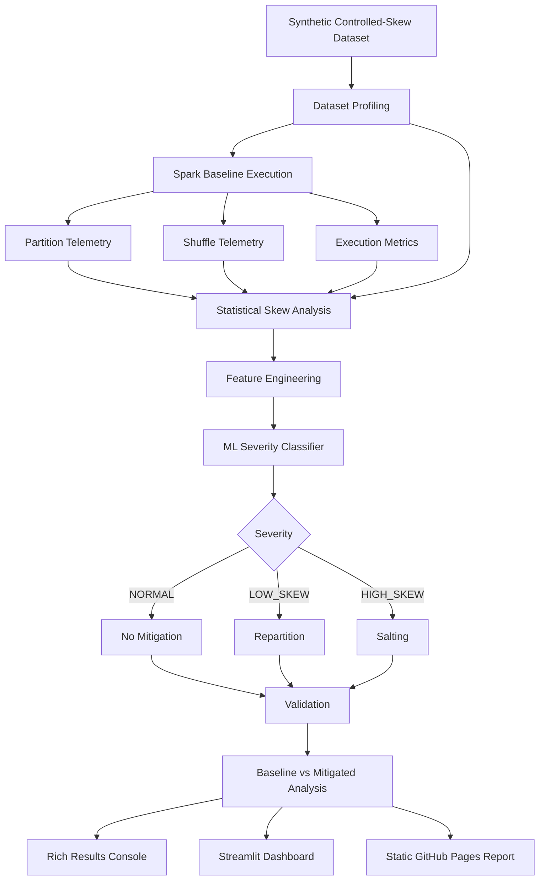

# Data Skew Intelligence

### An Intelligent Apache Spark System for Detecting, Explaining, Classifying, and Mitigating Data Skew

<p align="center">
  <a href="https://github.com/SanyogSingh07/data-skew-intelligence">
    
  </a>
  <a href="https://github.com/SanyogSingh07/data-skew-intelligence/network/members">
    
  </a>
  <a href="https://github.com/SanyogSingh07/data-skew-intelligence/actions">
    
  </a>
  <a href="https://github.com/SanyogSingh07/data-skew-intelligence/blob/main/LICENSE">
    
  </a>
  
  
  
  
</p>

<p align="center">
  <a href="https://sanyogsingh07.github.io/data-skew-intelligence/">
    <strong>Open Live Benchmark</strong>
  </a>
  &nbsp;&nbsp;•&nbsp;&nbsp;
  <a href="https://github.com/SanyogSingh07/data-skew-intelligence">
    <strong>Explore Source</strong>
  </a>
  &nbsp;&nbsp;•&nbsp;&nbsp;
  <a href="https://github.com/SanyogSingh07/data-skew-intelligence/actions">
    <strong>Build & Deploy</strong>
  </a>
</p>

---

## About the Project

Distributed systems are designed to divide work. Data skew is one of the clearest ways that apparently parallel work can become uneven again.

When a small number of keys account for a disproportionate share of records, Spark can produce highly imbalanced partitions. Some tasks finish quickly, while one or more overloaded tasks become stragglers. The result can be poor parallelism, uneven executor utilization, greater shuffle pressure, and unpredictable execution behaviour.

**Data Skew Intelligence** was built to make that problem visible and measurable.

The project creates controlled skewed datasets, profiles the distribution, executes a Spark workload, captures partition and shuffle telemetry, quantifies imbalance statistically, converts the observations into machine-learning features, classifies the severity of skew, selects an appropriate mitigation strategy, executes the mitigation, and validates the result.

It is therefore not just a demonstration of salting.

It is a complete experimental loop:

```text
Generate
   ↓
Profile
   ↓
Measure
   ↓
Explain
   ↓
Classify
   ↓
Recommend
   ↓
Mitigate
   ↓
Validate
   ↓
Report
```

The system brings together **data engineering, distributed systems, statistical analysis, machine learning, observability, optimization, visualization, testing, and deployment** in one reproducible repository.

---

## The Project in One View

<table>
<tr>
<td width="50%">

### The Problem

A dominant key can turn a logically parallel Spark workload into a physically uneven execution plan.

```text
Hot Key
  ↓
Large Shuffle Group
  ↓
Large Partition
  ↓
Straggler
  ↓
Uneven Workload
  ↓
Poorer Scalability
```

</td>
<td width="50%">

### The Response

The system observes the workload and builds evidence before applying a mitigation.

```text
Telemetry
   ↓
Metrics
   ↓
ML Classification
   ↓
Mitigation
   ↓
Validation
```

</td>
</tr>
</table>

---

## The Live Demo, Inside the README

GitHub repository pages do not allow a README to safely render an arbitrary interactive iframe from an external website. For that reason, the correct approach is to put the **actual project output directly on the README page** and make the preview itself open the live application.

### Click the benchmark preview to open the live project

<p align="center">
  <a href="https://sanyogsingh07.github.io/data-skew-intelligence/">
    
  </a>
</p>

<p align="center">
  <strong>Interactive benchmark:</strong>
  <a href="https://sanyogsingh07.github.io/data-skew-intelligence/">
    sanyogsingh07.github.io/data-skew-intelligence
  </a>
</p>

The page above is not a decorative screenshot. It represents the same benchmark/reporting workflow produced by the repository and deployed through GitHub Pages.

The live report currently exposes:

- Baseline versus mitigated execution metrics
- Maximum partition load
- Partition-load standard deviation
- Top-key concentration
- Partition visualizations
- Skew-versus-runtime analysis
- Performance comparison
- Telemetry summary
- Exported CSV and JSON artifacts

**This is the primary project demonstration.**

---

## Evidence Before Explanation

The repository already contains eight visual assets. They should remain part of the README because they explain the system faster than paragraphs of implementation detail.

### 01 — Key Distribution

<a href="https://sanyogsingh07.github.io/data-skew-intelligence/">
  
</a>

The first question is not "How do we mitigate the problem?"

It is:

> Where is the concentration coming from?

This visualization establishes the logical source of the skew.

---

### 02 — Physical Partition Distribution

<a href="https://sanyogsingh07.github.io/data-skew-intelligence/">
  
</a>

The second question is:

> How does the logical concentration manifest physically inside Spark?

This is where data distribution becomes a distributed execution problem.

---

### 03 — Before and After Partition Balance

<a href="https://sanyogsingh07.github.io/data-skew-intelligence/">
  
</a>

This is the most important mitigation visual.

It shows whether the optimization actually changed the distribution of work across partitions.

---

### 04 — Runtime Behaviour Across Skew Levels

<a href="https://sanyogsingh07.github.io/data-skew-intelligence/">
  
</a>

This experiment studies how increasing key concentration changes observed execution behaviour.

---

### 05 — Overall Performance Comparison

<a href="https://sanyogsingh07.github.io/data-skew-intelligence/">
  
</a>

This provides the consolidated benchmark view across the principal execution metrics.

---

### 06 — Skew Versus Partition Variability

<a href="https://sanyogsingh07.github.io/data-skew-intelligence/">
  
</a>

This connects logical skew intensity with physical partition-load variability.

---

### 07 — Pipeline Execution



The terminal view demonstrates that the system is not just a visual dashboard. The complete experiment can be executed from the CLI.

---

### 08 — Results Console



The Rich results console provides a structured way to inspect experiments without opening the web dashboard.

---

## What Makes This Different

The important part of this project is not any single technology.

Spark can repartition.

Spark can salt keys.

scikit-learn can train a classifier.

Streamlit can display a chart.

The engineering value comes from connecting those components into one decision system.

```text
Data Distribution
        ↓
Spark Execution
        ↓
Telemetry Collection
        ↓
Statistical Analysis
        ↓
Feature Engineering
        ↓
ML Severity Classification
        ↓
Mitigation Recommendation
        ↓
Repartition / Salting
        ↓
Post-Mitigation Validation
        ↓
Benchmark Reporting
```

The ML component is therefore not an isolated model-training exercise. It sits between observability and an operational decision.

---

## Current Benchmark Snapshot

The public GitHub Pages release currently reports:

| Metric | Baseline | Mitigated |
|---|---:|---:|
| Execution time | 0.34 s | 0.42 s |
| Maximum partition load | 7,394 | 2,132 |
| Partition-load standard deviation | 2,322.69 | 437.26 |
| Aggregation correctness | Validated | Validated |

The maximum partition load is reduced by approximately **71.2%**, while partition-load standard deviation falls by approximately **81.2%**.

The runtime result should be interpreted in context. The current benchmark is a small local experiment, and salting adds computation and aggregation overhead. The stronger evidence is the substantial reduction in partition concentration while preserving logical correctness.

Source: current public benchmark report.  
https://sanyogsingh07.github.io/data-skew-intelligence/

---

## Technical Positioning

This repository sits at the intersection of:

| Area | What the project demonstrates |
|---|---|
| Data Engineering | Spark, Parquet, partitioning, shuffle, aggregation |
| Distributed Systems | Skew, stragglers, workload imbalance, mitigation |
| Machine Learning | Feature engineering, classification, model comparison |
| Data Analysis | Distribution analysis, concentration, CV, skew metrics |
| MLOps / Engineering | Experiment orchestration, persistence, validation |
| Visualization | Matplotlib, Plotly, static reporting |
| Developer Tooling | Typer, Rich, automated CLI workflows |
| Deployment | Docker, GitHub Actions, GitHub Pages |
| Quality Engineering | Pytest, coverage, smoke testing |

---

# Table of Contents

- [Project at a Glance](#project-at-a-glance)
- [Live Project](#live-project)
- [The Problem](#the-problem)
- [Why Data Skew Matters](#why-data-skew-matters)
- [Project Objectives](#project-objectives)
- [Design Philosophy](#design-philosophy)
- [System Architecture](#system-architecture)
- [Execution Lifecycle](#execution-lifecycle)
- [Core Capabilities](#core-capabilities)
- [Controlled Skew Generation](#controlled-skew-generation)
- [Spark Telemetry](#spark-telemetry)
- [Statistical Skew Analysis](#statistical-skew-analysis)
- [Machine Learning Pipeline](#machine-learning-pipeline)
- [Mitigation Engine](#mitigation-engine)
- [Validation and Benchmarking](#validation-and-benchmarking)
- [Results and Interpretation](#results-and-interpretation)
- [Interactive Results Console](#interactive-results-console)
- [Visualization Layer](#visualization-layer)
- [Streamlit Dashboard](#streamlit-dashboard)
- [GitHub Pages Reporting](#github-pages-reporting)
- [CLI Reference](#cli-reference)
- [One-Command Pipeline](#one-command-pipeline)
- [Docker](#docker)
- [CI/CD](#cicd)
- [Testing and Verification](#testing-and-verification)
- [Repository Structure](#repository-structure)
- [Configuration](#configuration)
- [Technical Design](#technical-design)
- [Reproducibility](#reproducibility)
- [Engineering Trade-offs](#engineering-trade-offs)
- [Limitations](#limitations)
- [Roadmap](#roadmap)
- [Academic Context](#academic-context)
- [Contributing](#contributing)
- [License](#license)
- [Author](#author)

---

# The Problem

Apache Spark divides work across partitions so that computations can execute in parallel.

That model works extremely well when data is reasonably distributed.

It becomes considerably less efficient when a small number of keys dominate the dataset.

Consider a simplified dataset:

```text
KEY_00000 → 70% of records
KEY_00001 →  5%
KEY_00002 →  4%
KEY_00003 →  3%
...
```

A group-by or similar shuffle operation can cause a disproportionate amount of work to accumulate around one logical key.

The problem evolves from a data-distribution issue into a distributed-execution issue:

```text
Hot Key
   ↓
Large Shuffle Group
   ↓
Large Physical Partition
   ↓
Straggler Task
   ↓
Uneven Executor Utilization
   ↓
Higher Tail Latency
   ↓
Potential Memory / Shuffle Pressure
```

The important point is that Spark does not execute the abstract concept of "70% skew." It executes tasks against physical partitions.

The project therefore studies the transition:

```text
Logical Skew
     ↓
Physical Partition Imbalance
     ↓
Observed Spark Behaviour
```

That transition is the central engineering problem addressed by this repository.

---

# Why Data Skew Matters

A skewed distributed workload creates several classes of operational problems.

### Parallelism becomes less effective

If one task receives substantially more data than the others, additional parallelism cannot fully compensate for the imbalance.

### Stragglers determine completion time

Many distributed workloads effectively finish when their slowest important task finishes. A heavily skewed partition can therefore dominate the end of a stage.

### Resource utilization becomes uneven

Some executors may become idle while another executor continues processing a disproportionately large partition.

### Shuffle pressure increases

Grouping, joining, and aggregating skewed data can increase the cost of moving and processing records across the cluster.

### Scaling becomes less predictable

A workload that looks reasonable on a small dataset can become increasingly problematic as the volume of records associated with the dominant keys grows.

Data Skew Intelligence focuses specifically on making these behaviours visible and measurable.

---

# Project Objectives

The system was designed around the following objectives.

## 1. Generate Controlled Skew

Create reproducible datasets where the concentration of one or more keys can be deliberately varied.

## 2. Establish a Baseline

Execute a Spark workload without mitigation and collect physical execution metrics.

## 3. Quantify Skew

Use both key-level and partition-level metrics to describe imbalance.

## 4. Convert Telemetry into ML Features

Transform runtime and distribution information into a structured classification dataset.

## 5. Classify Severity

Predict whether the observed condition is:

```text
NORMAL
LOW_SKEW
HIGH_SKEW
```

## 6. Select a Mitigation Strategy

Map severity to a concrete Spark mitigation approach.

## 7. Execute the Mitigation

Use repartitioning or salted aggregation based on the selected strategy.

## 8. Validate the Result

Measure partition balance and confirm logical correctness after mitigation.

## 9. Produce Reproducible Evidence

Export the resulting metrics, charts, JSON, CSV, and static dashboard artifacts.

## 10. Make the System Reviewable

Expose the workflow through a CLI, interactive console, Streamlit dashboard, and public GitHub Pages benchmark.

---

# Design Philosophy

The project is built around five principles.

## Measure Before Optimizing

A mitigation should be motivated by observed workload characteristics rather than applied blindly.

## Separate Logical and Physical Behaviour

A concentrated key distribution is a logical property. A large Spark partition is a physical execution consequence. The system observes both.

## Use Multiple Signals

No single statistic fully describes distributed skew. The project therefore combines key concentration, partition distribution, coefficient of variation, skew ratio, execution time, and shuffle telemetry.

## Validate the Optimization

A mitigation is not considered successful simply because the code completes. The project compares the workload before and after the intervention.

## Keep the Experiment Reproducible

The same repository contains the data-generation logic, execution logic, ML logic, reporting logic, tests, configuration, and deployment workflow.

---

# System Architecture



---

# Internal Architecture

The existing repository is intentionally divided into functional layers.

```text
data-skew-intelligence/
│
├── Data Layer
│   └── Controlled synthetic skew generation
│
├── Spark Layer
│   ├── SparkSession management
│   ├── Baseline execution
│   ├── Skew analysis
│   ├── Metrics collection
│   └── Mitigation algorithms
│
├── ML Layer
│   ├── Feature engineering
│   ├── Model training
│   ├── Evaluation
│   └── Severity prediction
│
├── Core Layer
│   ├── Configuration
│   ├── Environment validation
│   ├── Pipeline orchestration
│   └── Result persistence
│
├── Interface Layer
│   ├── Typer CLI
│   ├── Rich interactive console
│   └── Streamlit dashboard
│
├── Reporting Layer
│   ├── Matplotlib charts
│   ├── Result tables
│   ├── Export utilities
│   └── Static site generation
│
└── Verification Layer
    ├── Unit tests
    ├── Integration tests
    ├── Smoke tests
    └── GitHub Actions
```

The existing repository already contains these functional areas and their associated modules; this README documents them rather than introducing a new architecture. ([github.com](https://github.com/SanyogSingh07/data-skew-intelligence))

---

# Execution Lifecycle

The project currently exposes a nine-step master pipeline.

| Step | Phase | What Happens |
|---:|---|---|
| 1/9 | Environment | Validates Java JDK 17+, PySpark, and scikit-learn |
| 2/9 | Dataset | Generates controlled-skew synthetic data |
| 3/9 | EDA / Skew Analysis | Computes key-frequency statistics, Z-score, and SkewScore |
| 4/9 | Spark Baseline | Executes the workload and captures Spark telemetry |
| 5/9 | ML Training | Trains three classifiers and selects the best by F1 |
| 6/9 | Detection / Severity | Produces a severity prediction and mitigation recommendation |
| 7/9 | Mitigation | Applies salting or repartitioning |
| 8/9 | Verification | Runs the automated unit and integration tests |
| 9/9 | Results Export | Writes JSON metrics, PNG charts, and CSV data |

This full orchestration already exists in the repository's `run.py` and `core/pipeline.py`; the README is intentionally preserving that workflow. ([github.com](https://github.com/SanyogSingh07/data-skew-intelligence))

---

# Core Capabilities

| Capability | Current Implementation |
|---|---|
| Controlled skew generation | Configurable synthetic datasets with skew ratios from 10% to 90% |
| Partition telemetry | Physical partition statistics and shuffle I/O |
| Statistical analysis | Z-score, coefficient of variation, skew ratio, and SkewScore |
| ML severity classification | Logistic Regression, Decision Tree, Random Forest |
| Model selection | Macro F1-based selection |
| Mitigation | Repartitioning and two-phase salted aggregation |
| CLI | Typer + Rich |
| Results Console | Nine navigation options |
| Visualization | Six Matplotlib engineering charts |
| Web dashboard | Streamlit + Plotly |
| Static reporting | HTML/CSS/JS export |
| Containerization | Docker + Docker Compose |
| CI/CD | GitHub Actions |
| Verification | 33 unit and integration tests |
| Public reporting | GitHub Pages |

---

# Controlled Skew Generation

The experiment begins with a synthetic dataset generator.

The purpose of the generator is not to simulate a particular business domain. It is to control the distribution of the grouping key so that the execution environment can be stressed intentionally.

The system supports configurable skew levels such as:

```text
10%
30%
50%
70%
90%
```

The project can therefore study the progression:

```text
Low Concentration
      ↓
Moderate Concentration
      ↓
High Concentration
      ↓
Extreme Concentration
```

The generated data is persisted in Parquet form and can be inspected independently before execution.

Example:

```bash
python -m cli.app data generate --rows 100000 --skew 0.70
```

Then:

```bash
python -m cli.app data inspect --input data/generated/skew_70.parquet
```

This separation between generation and execution is important because it allows the same dataset to be used across multiple experiments.

---

# Spark Telemetry

The baseline layer is responsible for observing the physical execution consequences of skew.

The existing implementation records metrics including:

- Maximum partition size
- Mean partition size
- Partition standard deviation
- Coefficient of variation
- Skew ratio
- Execution wall-clock time
- Shuffle read bytes
- Key concentration

These measurements form the bridge between the data layer and the ML layer.

Conceptually:

```text
Dataset Profile
      +
Spark Execution Metrics
      +
Partition Distribution
      +
Shuffle Telemetry
      ↓
Skew Intelligence Feature Set
```

---

# Statistical Skew Analysis

The project combines multiple complementary indicators.

## Skew Ratio

```text
Skew Ratio =
Maximum Partition Size
----------------------
Mean Partition Size
```

A value closer to `1.0` indicates relatively even partition sizes.

A higher value indicates that the largest partition is increasingly dominating the workload.

---

## Coefficient of Variation

```text
CV =
Partition Standard Deviation
----------------------------
Mean Partition Size
```

The coefficient of variation normalizes partition variability by the average partition size.

This makes it more useful when comparing experiments with different overall record counts.

---

## Key Concentration

The system also measures concentration at the key level.

Two useful indicators are:

```text
Top-1 concentration
Top-5 concentration
```

These capture how much of the dataset is controlled by the most dominant keys.

---

## Z-Score and SkewScore

The repository's analysis layer also includes Z-score and SkewScore calculations.

These provide an additional statistical representation of unusually large partitions and highly uneven distributions.

The purpose is not to replace Spark telemetry with a single "magic number", but to construct a richer evidence set for severity classification.

---

# Machine Learning Pipeline

The ML layer turns the telemetry collected from Spark into a structured classification problem.

The current target classes are:

```text
NORMAL
LOW_SKEW
HIGH_SKEW
```

The system evaluates three models.

| Model | Configuration | Purpose |
|---|---|---|
| Logistic Regression | `max_iter=1000` with scaling | Linear baseline |
| Decision Tree | `max_depth=6` | Interpretable non-linear baseline |
| Random Forest | `n_estimators=200`, `max_depth=10` | Ensemble model |

The repository selects the strongest candidate using macro F1 rather than relying exclusively on raw accuracy. ([github.com](https://github.com/SanyogSingh07/data-skew-intelligence))

---

# ML Feature Engineering

The classifier currently consumes nine engineered telemetry features.

| Feature | Definition / Meaning |
|---|---|
| `skew_ratio` | Maximum partition divided by mean partition |
| `coefficient_of_variation` | Partition standard deviation divided by mean |
| `max_partition_size` | Record count of the largest physical partition |
| `mean_partition_size` | Mean records per partition |
| `partition_std` | Standard deviation of partition sizes |
| `execution_time_sec` | Spark wall-clock execution time |
| `top1_concentration` | Fraction of records belonging to the hottest key |
| `top5_concentration` | Fraction of records belonging to the five hottest keys |
| `shuffle_read_bytes` | Spark shuffle-read I/O |

This is intentionally a telemetry-driven feature set.

The classifier is not trained only on the configured skew parameter. It receives signals derived from the observed execution itself.

---

# Why Macro F1

The severity problem is multi-class.

A model that performs well on the dominant class can still perform poorly when distinguishing less frequent severity categories.

Macro F1 gives each class equal weight when evaluating the classifier.

That makes it a more informative selection criterion for a severity classifier than accuracy alone.

The repository therefore follows:

```text
Train
  ↓
Evaluate multiple models
  ↓
Calculate classification metrics
  ↓
Compare Macro F1
  ↓
Select strongest model
```

The exact winning model and metric values should be generated from the current experiment outputs rather than hard-coded into this README, ensuring the documentation does not become stale when new benchmarks are run.

---

# Mitigation Engine

The decision layer maps classification results to mitigation behaviour.

```text
NORMAL
    ↓
NONE

LOW_SKEW
    ↓
REPARTITION

HIGH_SKEW
    ↓
SALTING
```

The repository currently implements both mitigation paths. ([github.com](https://github.com/SanyogSingh07/data-skew-intelligence))

---

## Repartitioning

For lower-severity skew, the project uses shuffle repartitioning.

The current decision rule uses a two-times shuffle-partition setting for the LOW_SKEW path.

Conceptually:

```text
Uneven Partition Distribution
            ↓
      More Shuffle Partitions
            ↓
   Redistribute Records
            ↓
    More Balanced Workload
```

Repartitioning is useful when the problem is significant enough to justify redistribution but does not require the extra key expansion introduced by salting.

---

## Salting

For high-severity hot-key concentration, the system uses salted aggregation.

The current implementation uses eight salt buckets and a two-phase aggregation path.

Conceptually:

```text
Original Key
     |
     +-----------------------------+
     |       |       |       |     |
   Salt 0  Salt 1  Salt 2  ...   Salt 7
     |       |       |             |
     +-------+-------+-------------+
             |
       Partial Aggregation
             |
       Final Aggregation
```

Instead of allowing one dominant key to form one dominant shuffle group, salting distributes the logical workload across multiple salted variants.

The final aggregation phase reconstructs the result.

The critical property is correctness: the mitigation must improve distribution without changing the logical result.

---

# Validation and Benchmarking

The benchmark system evaluates multiple dimensions rather than using runtime alone.

### Partition-level metrics

- Maximum partition record count
- Mean partition record count
- Partition standard deviation
- Coefficient of variation
- Skew ratio

### Data-distribution metrics

- Top-1 key concentration
- Top-5 key concentration
- Key-frequency distribution

### Spark execution metrics

- Execution wall-clock time
- Shuffle-read I/O
- Physical partition distribution

### Correctness

- Aggregation equivalence between baseline and mitigated outputs

The comparison therefore becomes:

```text
             Baseline
                |
       +--------+--------+
       |        |        |
   Balance   Runtime   Correctness
       |        |        |
       +--------+--------+
                |
            Mitigation
                |
       +--------+--------+
       |        |        |
   Balance   Runtime   Correctness
```

---

# Results and Interpretation

The currently deployed GitHub Pages release reports the following benchmark:

| Metric | Baseline | Mitigated |
|---|---:|---:|
| Execution time | 0.34 s | 0.42 s |
| Maximum partition load | 7,394 | 2,132 |
| Partition-load standard deviation | 2,322.69 | 437.26 |
| Aggregation correctness | Validated | Validated |

Source: current public GitHub Pages release report. ([sanyogsingh07.github.io](https://sanyogsingh07.github.io/data-skew-intelligence/))

The maximum partition load reduction is approximately:

```text
(7394 - 2132) / 7394 × 100
≈ 71.2%
```

The partition-load standard deviation reduction is approximately:

```text
(2322.69 - 437.26) / 2322.69 × 100
≈ 81.2%
```

### Why the runtime number should be interpreted carefully

The current benchmark shows:

```text
Baseline    0.34 s
Mitigated   0.42 s
```

That does not invalidate the mitigation.

For a small local benchmark, salting introduces additional processing and aggregation work. Spark startup, JVM overhead, local machine behaviour, and shuffle overhead can dominate the execution time.

The stronger observation is that the mitigation materially reduces partition concentration while maintaining logical correctness.

This is an important distributed-systems distinction:

> Better workload distribution does not automatically imply lower wall-clock runtime on every dataset and execution environment.

A larger workload, a longer-running cluster job, or a more pronounced straggler condition can produce a different runtime relationship.

---

# Results Console

After the master pipeline completes, the existing Rich-powered Results Console provides nine navigation paths.

| Option | View |
|---:|---|
| 1 | Latest Experiment Summary |
| 2 | Experiment History |
| 3 | Dataset Profile and Top-Key Distribution |
| 4 | Spark Execution Telemetry |
| 5 | Before / After Performance Comparison |
| 6 | ML Classifier Diagnostics |
| 7 | Generated PNG Charts |
| 8 | Run Pipeline Again |
| 9 | Exit |

This creates a terminal-first workflow for inspecting experiment output without needing to open the Streamlit dashboard.

---

# Visualization Layer

The repository currently includes six engineering visualizations generated through Matplotlib.

The visualization system uses a consistent NVIDIA-inspired dark engineering theme.

## 1. Key Distribution

Shows how strongly the data is concentrated around the dominant keys.

The current experiment example includes a top key holding 70% of the total dataset in the public benchmark release, while the README's original sample experiment also documents an extreme 94.2% hot-key concentration in a 10,000-row scenario. These represent different experimental snapshots and should not be treated as the same run. ([sanyogsingh07.github.io](https://sanyogsingh07.github.io/data-skew-intelligence/))

## 2. Physical Partition Distribution

Shows how logical key concentration manifests physically across Spark partitions.

## 3. Before vs After Partition Balance

Directly compares partition sizes after the selected mitigation strategy.

## 4. Performance Comparison

Places runtime and partition-size metrics side by side.

## 5. Skew Percentage vs Execution Time

Studies how increasing key concentration affects wall-clock execution behaviour.

## 6. Skew Percentage vs Partition CV

Shows the relationship between key concentration and partition-load variability.

The repository already implements these six chart generators in `visualization/charts.py`. ([github.com](https://github.com/SanyogSingh07/data-skew-intelligence))

---

# Streamlit Dashboard

The project contains a three-tab interactive dashboard.

Launch it using:

```bash
python run.py --dashboard
```

or:

```bash
python -m cli.app dashboard launch --port 8501
```

The dashboard includes:

## Experiments Benchmark

Compare experiments and visualize before/after mitigation behaviour with Plotly.

## Persisted Data and Distributions

Explore:

- Key frequency distributions
- Partition distributions
- Generated experiment data

## ML Model Diagnostics

Compare:

- Accuracy
- Precision
- Recall
- F1

This dashboard is intended for local interactive exploration, while the GitHub Pages deployment is designed for public, lightweight result sharing.

---

# GitHub Pages Reporting

The project has a dedicated static reporting path.

The workflow is:

```text
Experiment
    ↓
Result Artifacts
    ↓
Static Site Generator
    ↓
HTML / CSS / JS
    ↓
GitHub Pages
```

The repository's static exporter produces the site used at:

https://sanyogsingh07.github.io/data-skew-intelligence/

The GitHub Actions Pages workflow currently runs the quick pipeline, exports the static site, and deploys the resulting `site/` directory to GitHub Pages. ([github.com](https://github.com/SanyogSingh07/data-skew-intelligence))

---

# CLI Reference

The repository exposes a complete `skewctl`-style interface through Typer and Rich.

## Environment

### System readiness

```bash
python -m cli.app system check
```

---

## Data

### Generate controlled-skew dataset

```bash
python -m cli.app data generate \
    --rows 100000 \
    --skew 0.70
```

### Inspect generated dataset

```bash
python -m cli.app data inspect \
    --input data/generated/skew_70.parquet
```

---

## Spark

### Run baseline

```bash
python -m cli.app spark baseline \
    --input data/generated/skew_70.parquet
```

### Analyze skew

```bash
python -m cli.app spark analyze \
    --input data/generated/skew_70.parquet
```

---

## Machine Learning

### Build ML dataset

```bash
python -m cli.app ml build-dataset
```

### Train models

```bash
python -m cli.app ml train
```

### Evaluate models

```bash
python -m cli.app ml evaluate
```

### Predict severity

```bash
python -m cli.app ml predict \
    --input data/generated/skew_70.parquet
```

---

## Mitigation

### Repartition

```bash
python -m cli.app mitigate repartition \
    --input data/generated/skew_70.parquet
```

### Salting

```bash
python -m cli.app mitigate salt \
    --input data/generated/skew_70.parquet
```

### Automated mitigation

```bash
python -m cli.app mitigate auto \
    --input data/generated/skew_70.parquet
```

---

## Experiments

### Run an experiment

```bash
python -m cli.app experiment run \
    --rows 100000 \
    --skew 0.90 \
    --mitigation auto
```

### Compare experiments

```bash
python -m cli.app experiment compare
```

---

## Dashboard

```bash
python -m cli.app dashboard launch --port 8501
```

All of the command groups above are already present in the existing repository and are retained in this README without renaming or removing the current interface. ([github.com](https://github.com/SanyogSingh07/data-skew-intelligence))

---

# One-Command Pipeline

The repository already provides a top-level orchestration entrypoint through `run.py`.

## Standard execution

```bash
python run.py
```

Runs the full pipeline and interactive results console.

## Quick mode

```bash
python run.py --quick
```

Runs the smaller quick experiment using 10,000 rows.

## Environment validation

```bash
python run.py --check
```

## Dashboard after execution

```bash
python run.py --dashboard
```

## Clean execution

```bash
python run.py --clean
```

## Non-interactive execution

```bash
python run.py --no-menu
```

Useful for automation, CI, and scripted workflows.

## Export the static GitHub Pages report

```bash
python run.py --export-site
```

## Windows one-click launcher

```text
run.bat
```

The existing one-command and CLI interfaces are intentionally preserved as-is. ([github.com](https://github.com/SanyogSingh07/data-skew-intelligence))

---

# Installation

## Requirements

| Requirement | Version |
|---|---|
| Python | 3.11+ |
| Java JDK | 17+ |
| pip | Latest recommended |
| PySpark | Defined in `requirements.txt` |
| scikit-learn | Defined in `requirements.txt` |

The repository currently recommends Java 17 and validates the environment before pipeline execution.

---

## Clone the Repository

```bash
git clone https://github.com/SanyogSingh07/data-skew-intelligence.git
cd data-skew-intelligence
```

---

## Create a Virtual Environment

```bash
python -m venv .venv
```

### Windows

```powershell
.\.venv\Scripts\activate
```

### macOS / Linux

```bash
source .venv/bin/activate
```

---

## Install Dependencies

```bash
pip install -r requirements.txt
```

For development and testing:

```bash
pip install -r requirements-dev.txt
```

---

## Verify the Environment

```bash
python run.py --check
```

---

# Docker

The project maintains both Docker and Docker Compose support.

## Docker Compose

```bash
docker compose up --build
```

The standard services expose:

```text
Streamlit → http://localhost:8501
Spark UI  → http://localhost:4040
```

The Spark UI is available when a Spark job is actively running.

---

## Standalone Docker Image

Build:

```bash
docker build -t data-skew-intelligence .
```

System check:

```bash
docker run --rm data-skew-intelligence
```

Run the quick pipeline:

```bash
docker run --rm \
  data-skew-intelligence \
  python run.py --quick --no-menu
```

Launch Streamlit:

```bash
docker run --rm -p 8501:8501 data-skew-intelligence \
  python -m streamlit run dashboard/app.py \
  --server.port=8501 \
  --server.address=0.0.0.0
```

These Docker execution paths already exist in the repository and are documented here without changing their current behaviour. ([github.com](https://github.com/SanyogSingh07/data-skew-intelligence))

---

# CI/CD

The repository currently uses three GitHub Actions workflows.

```text
.github/workflows/
├── ci.yml
├── benchmark.yml
└── pages.yml
```

---

## CI Workflow

The CI workflow runs on pushes and pull requests to `main`.

The existing sequence is:

```text
Python 3.11
Java 17 / Temurin
      ↓
Install Dependencies
      ↓
Environment Readiness Check
      ↓
Compileall
      ↓
Ruff
      ↓
Pytest + Coverage
      ↓
Quick Smoke Test
      ↓
Static Site Export
```

The smoke path includes:

```bash
python run.py --quick --no-menu --export-site
```

This is valuable because the CI system does not only test individual functions; it also exercises the end-to-end pipeline and static report generation. ([github.com](https://github.com/SanyogSingh07/data-skew-intelligence))

---

## Benchmark Workflow

`benchmark.yml` is configured for manually triggered benchmark experiments.

The existing workflow is intended to support custom experiment parameters such as:

```text
rows = 100000
skew = 0.90
```

This makes it possible to run heavier benchmark scenarios without coupling every benchmark to the default CI path.

---

## GitHub Pages Workflow

`pages.yml` automatically publishes the generated static report on pushes to `main`.

Its current flow is:

```text
Push to main
    ↓
Quick pipeline
    ↓
Static site export
    ↓
Deploy site/
    ↓
GitHub Pages
```

This preserves a public benchmark that stays connected to the current repository state. ([github.com](https://github.com/SanyogSingh07/data-skew-intelligence))

---

# Testing and Verification

The repository currently contains 33 unit and integration tests spanning the major modules.

Run the full suite:

```bash
pytest
```

Run with coverage:

```bash
pytest -q --cov=. --cov-report=term-missing
```

---

## Existing Test Coverage

| Test Module | Focus |
|---|---|
| `test_data.py` | Data generation and profiling |
| `test_data_generation.py` | Controlled-skew dataset validity |
| `test_spark.py` | SparkSession lifecycle and configuration |
| `test_skew_analysis.py` | EDA, Z-score, SkewScore |
| `test_mitigation.py` | Salting and repartition correctness |
| `test_ml.py` | Model training and serialization |
| `test_ml_pipeline.py` | End-to-end ML pipeline |
| `test_cli.py` | CLI commands and argument parsing |
| `test_pipeline.py` | Master pipeline orchestration |
| `test_site_generator.py` | Static site export |
| `test_smoke.py` | Full pipeline smoke testing |

Specific modules can also be run independently:

```bash
pytest tests/test_data.py
pytest tests/test_spark.py
pytest tests/test_ml.py
pytest tests/test_mitigation.py
pytest tests/test_cli.py
pytest tests/test_smoke.py
```

The existing test suite is therefore both component-oriented and pipeline-oriented. ([github.com](https://github.com/SanyogSingh07/data-skew-intelligence))

---

# Repository Structure

The following structure reflects the current repository rather than a proposed replacement.

```text
data-skew-intelligence/
│
├── .github/
│   └── workflows/
│       ├── ci.yml                    # CI: lint, test, smoke
│       ├── benchmark.yml             # Manual benchmark experiments
│       └── pages.yml                 # GitHub Pages deployment
│
├── cli/
│   ├── app.py                        # skewctl CLI
│   ├── menu.py                       # Interactive Results Console
│   └── console.py                    # Banner and styled output
│
├── core/
│   ├── config.py                     # Project constants and paths
│   ├── environment.py                # Java / PySpark validation
│   ├── pipeline.py                   # 9-step master orchestrator
│   └── results.py                    # JSON metrics exporter
│
├── spark/
│   ├── session.py                    # SparkSession builder and JVM tuning
│   ├── generate_data.py              # Synthetic skew generator
│   ├── baseline.py                   # Spark execution telemetry
│   ├── analyze_skew.py               # EDA, Z-score, SkewScore
│   ├── metrics.py                    # Partition imbalance metrics
│   ├── mitigation.py                 # Salting and repartition algorithms
│   └── config.py                     # Spark / YAML configuration reader
│
├── ml/
│   ├── features.py                   # Feature engineering and vectors
│   ├── train.py                      # Three-model training tournament
│   ├── predict.py                    # Severity prediction and recommendation
│   └── evaluate.py                   # Accuracy, precision, recall, F1
│
├── visualization/
│   ├── charts.py                     # Six Matplotlib chart generators
│   ├── theme.py                      # NVIDIA-inspired dark theme
│   ├── tables.py                     # Rich table formatters
│   ├── exporter.py                   # Data export utilities
│   ├── validators.py                 # Chart input validators
│   └── site_generator.py             # Static HTML/CSS/JS exporter
│
├── dashboard/
│   └── app.py                        # Interactive three-tab dashboard
│
├── data/
│   └── generated/                    # Generated Parquet datasets
│
├── docs/
│   ├── architecture/                 # Technical design documents
│   └── screenshots/                  # README chart images
│
├── results/                           # Experiment and report outputs
│
├── tests/                             # Unit, integration, and smoke tests
│
├── run.py                             # Master Python entrypoint
├── run.bat                            # Windows launcher
├── config.yaml                        # Global configuration
├── Dockerfile                         # Container definition
├── docker-compose.yml                 # Container orchestration
├── pyproject.toml                     # Package and tooling configuration
├── requirements.txt                   # Runtime dependencies
├── requirements-dev.txt               # Development dependencies
├── CONTRIBUTING.md                    # Contribution guidelines
├── SECURITY.md                        # Security guidance
├── VISUALIZATION_CLI_RESULTS_UX_SPECIFICATION.md
└── LICENSE                            # MIT License
```

The structure above intentionally documents existing files instead of proposing a new directory hierarchy. ([github.com](https://github.com/SanyogSingh07/data-skew-intelligence))

---

# Configuration

The repository includes a centralized `config.yaml`.

That configuration layer is important because it keeps experiment parameters and Spark settings separate from the business logic.

The Spark configuration layer is exposed through:

```text
spark/config.py
```

while project-wide configuration and paths are handled through:

```text
core/config.py
```

This separation supports repeatable experiments and makes parameter changes easier to trace.

---

# Technical Design

## Data Layer

Responsible for:

- Synthetic dataset construction
- Configurable skew ratios
- Parquet persistence
- Dataset inspection

## Spark Layer

Responsible for:

- SparkSession construction
- JVM and Spark tuning
- Baseline execution
- Partition telemetry
- Skew metrics
- Repartitioning
- Salting

## ML Layer

Responsible for:

- Feature construction
- Model training
- Model evaluation
- Severity prediction
- Mitigation recommendation

## Core Layer

Responsible for:

- Configuration
- Environment checks
- Orchestration
- Result persistence

## Visualization Layer

Responsible for:

- Static charts
- Terminal tables
- Validation
- Export
- GitHub Pages generation

## Dashboard Layer

Responsible for:

- Interactive Plotly exploration
- Experiment comparison
- Distribution inspection
- ML diagnostics

## Verification Layer

Responsible for:

- Unit tests
- Integration tests
- Smoke tests
- CI execution

This modular structure makes it possible to change one component without rewriting the entire workflow.

---

# Technical Decision Flow

The end-to-end decision logic can be summarized as:

```text
                   ┌─────────────────┐
                   │  Input Dataset  │
                   └────────┬────────┘
                            ↓
                   ┌─────────────────┐
                   │ Spark Telemetry │
                   └────────┬────────┘
                            ↓
             ┌──────────────────────────────┐
             │ Statistical Feature Layer   │
             │                              │
             │ Skew Ratio                   │
             │ CV                           │
             │ Partition Statistics         │
             │ Key Concentration            │
             │ Shuffle Read                 │
             │ Execution Time               │
             └──────────────┬───────────────┘
                            ↓
                   ┌─────────────────┐
                   │ ML Classifier   │
                   └────────┬────────┘
                            ↓
                   ┌─────────────────┐
                   │ Severity Class  │
                   └────────┬────────┘
                            ↓
          ┌─────────────────┼──────────────────┐
          ↓                 ↓                  ↓
       NORMAL           LOW_SKEW          HIGH_SKEW
          ↓                 ↓                  ↓
        NONE          REPARTITION           SALTING
          \                 |                  /
           \                |                 /
            └───────────────┴────────────────┘
                            ↓
                   ┌─────────────────┐
                   │   Validation    │
                   └────────┬────────┘
                            ↓
                   ┌─────────────────┐
                   │ Benchmark Data  │
                   └────────┬────────┘
                            ↓
              ┌─────────────┼─────────────┐
              ↓             ↓             ↓
             CLI        Streamlit     GitHub Pages
```

---

# Reproducibility

A strong benchmark is only useful when another person can reproduce it.

This project addresses reproducibility in several ways.

### Deterministic Configuration

Experiment and Spark parameters can be controlled centrally.

### Synthetic Workloads

The dataset generator makes it possible to recreate similar skew conditions.

### Persisted Results

Metrics and generated artifacts can be saved and compared.

### CLI Automation

Experiments can be executed without manually navigating the codebase.

### CI Validation

The same project provides automated readiness, linting, testing, smoke execution, and static export.

### Public Reporting

The GitHub Pages release provides a public reference for the generated benchmark.

---

# Engineering Trade-offs

No optimization strategy is universally superior.

## Repartitioning vs Salting

| Aspect | Repartitioning | Salting |
|---|---|---|
| Implementation complexity | Lower | Higher |
| Extra key structure | No | Yes |
| Useful for moderate skew | Yes | Sometimes |
| Useful for severe hot-key skew | Limited | Stronger |
| Additional aggregation phase | No | Yes |
| Potential shuffle overhead | Yes | Yes |
| Main purpose | Redistribute partitions | Split hot keys |

The decision layer reflects this trade-off rather than applying salting to every workload.

---

# Why Partition Balance Matters

A common mistake when evaluating skew mitigation is to look only at total runtime.

A better analysis asks:

```text
How much work is assigned to the largest partition?
How variable are partition sizes?
How concentrated are the keys?
Did the mitigation preserve correctness?
What additional work did the mitigation introduce?
How does the effect change as the workload grows?
```

The current benchmark shows that partition concentration can be reduced dramatically even when a small local run does not produce an immediate wall-clock speedup.

That is precisely why the project records several classes of metrics instead of publishing a single performance number.

---

# Current Public Benchmark

The currently deployed GitHub Pages report shows:

```text
Baseline execution time:       0.34 s
Mitigated execution time:      0.42 s

Maximum partition load:
7,394 → 2,132

Partition-load standard deviation:
2,322.69 → 437.26

Top-1 key concentration:
70.0%

Aggregation correctness:
Validated
```

Source: current public benchmark release. ([sanyogsingh07.github.io](https://sanyogsingh07.github.io/data-skew-intelligence/))

For a technical review, the important takeaway is:

```text
Severe concentration
        ↓
Large partition imbalance
        ↓
Salted mitigation
        ↓
Much flatter physical distribution
        ↓
Correct result preserved
```

---

# Current Scope

The existing system is focused on controlled experiments around key-based skew and aggregation-style Spark workloads.

Within that scope it already covers:

- Controlled skew generation
- Dataset profiling
- Spark execution
- Partition telemetry
- Shuffle telemetry
- Statistical skew analysis
- ML classification
- Severity prediction
- Automated mitigation
- Repartitioning
- Salting
- Validation
- CLI execution
- Rich terminal reporting
- Streamlit visualization
- Static GitHub Pages reporting
- Docker execution
- GitHub Actions
- Automated testing

This README does not remove or replace any of those capabilities. It documents the current system as a cohesive engineering platform.

---

# Limitations

The project should be evaluated within its current experimental scope.

## Synthetic Data

Controlled synthetic workloads are intentionally useful for causality and reproducibility, but they cannot represent every production distribution.

## Local Spark Environment

Local execution does not reproduce all behaviours of a large multi-node Spark cluster.

## Runtime Sensitivity

Small runtime numbers can be heavily affected by:

- JVM startup
- SparkSession initialization
- Local CPU characteristics
- Memory availability
- Garbage collection
- Shuffle setup
- Serialization overhead

## ML Generalization

The trained classifier is constrained by the range and diversity of experiments used to create its training data.

## Mitigation Overhead

Salting can reduce partition concentration while introducing additional computation and aggregation work.

## Scope of Skew

The current project focuses on key-based partition skew. It does not attempt to model every Spark performance issue, including all join-pathologies, memory leaks, serialization bottlenecks, or cluster-level resource contention.

These limitations are part of the engineering context and should remain visible when interpreting the benchmark.

---

# Roadmap

The roadmap below extends the current project without replacing its existing architecture.

## Detection

- [x] Controlled skew generation
- [x] Key concentration analysis
- [x] Partition telemetry
- [x] Z-score analysis
- [x] CV-based imbalance analysis
- [x] Skew ratio tracking
- [x] ML severity classification

## Mitigation

- [x] Repartitioning
- [x] Salting
- [x] Automated strategy selection
- [x] Before/after partition comparison
- [x] Logical correctness validation

## Machine Learning

- [x] Feature engineering
- [x] Three-model tournament
- [x] Macro F1 model selection
- [x] Model evaluation
- [ ] Cross-validation across larger workload families
- [ ] Hyperparameter optimization
- [ ] Model version tracking
- [ ] MLflow integration

## Distributed Systems

- [ ] Skewed join workloads
- [ ] Adaptive salt-bucket sizing
- [ ] Cost-aware mitigation decisions
- [ ] Multi-node Spark benchmarks
- [ ] Dynamic partition monitoring
- [ ] Broader Spark 4.x validation

## Observability

- [ ] Prometheus integration
- [ ] Grafana dashboards
- [ ] Historical telemetry tracking
- [ ] Long-running experiment monitoring

## Deployment

- [ ] FastAPI inference service
- [ ] Cloud-based Spark experiments
- [ ] AWS EMR integration
- [ ] Google Cloud Dataproc integration
- [ ] Infrastructure-as-code

The roadmap is intentionally additive: existing CLI, Spark, ML, visualization, dashboard, test, Docker, and GitHub Pages functionality remains the foundation.

---

# Technical Documentation

The repository already contains technical design material under:

```text
docs/architecture/
```

and a dedicated visualization / CLI UX specification:

```text
VISUALIZATION_CLI_RESULTS_UX_SPECIFICATION.md
```

The recommended documentation hierarchy is:

```text
README.md
    ↓
Project overview and reproducibility

docs/architecture/
    ↓
Detailed implementation and architecture

VISUALIZATION_CLI_RESULTS_UX_SPECIFICATION.md
    ↓
Visualization and terminal UX details

GitHub Pages
    ↓
Generated benchmark evidence
```

This keeps the root README readable while retaining deeper engineering documentation inside the repository.

---

# Academic Context

**Project ID:** `23BTRDC034`

**Course / Domain:** Data Engineering / Big Data Analytics with Apache Spark

**Primary Platform:** Apache Spark / PySpark

**Primary Language:** Python

**Core Research Theme:** Data Skew Detection and Resolution

The academic objective is to create an intentionally skewed workload, observe its effect on distributed execution, and implement a mitigation strategy such as salting or repartitioning.

The engineering implementation extends that assignment by introducing:

- Spark telemetry
- Statistical severity analysis
- Machine-learning classification
- Automated mitigation selection
- Interactive result exploration
- Static public reporting
- Automated CI/CD
- Reproducible experiment execution

This transforms a narrow skew demonstration into a complete experimental system.

---

# What This Project Demonstrates

The project should be understood as an intersection of several disciplines.

### Data Engineering

Partitioning, shuffling, Parquet, distributed aggregation, Spark execution metrics.

### Machine Learning

Feature engineering, classification, model comparison, macro F1 evaluation.

### Data Analysis

Distribution analysis, concentration metrics, statistical variance, benchmark comparison.

### Distributed Systems

Workload balancing, stragglers, partition-level bottlenecks, mitigation trade-offs.

### Software Engineering

CLI design, modular architecture, testing, configuration, Docker, CI/CD.

### Technical Communication

Static reporting, visualization, public benchmarks, architecture documentation.

The strongest part of the system is the connection between these layers.

---

# Engineering Narrative

At the core, the project asks a simple question:

> Can a distributed data processing system observe its own workload imbalance well enough to make an informed mitigation decision?

The implementation approaches the question as an experimental control loop.

```text
Observe
   ↓
Quantify
   ↓
Classify
   ↓
Act
   ↓
Measure Again
```

The model is therefore not being used as an isolated machine-learning demo.

It participates in an engineering decision pipeline.

That distinction is central to the project's design.

---

# Quick Start

For a first-time run:

```bash
git clone https://github.com/SanyogSingh07/data-skew-intelligence.git
cd data-skew-intelligence

python -m venv .venv
```

Activate the environment.

### Windows

```powershell
.\.venv\Scripts\activate
```

### macOS / Linux

```bash
source .venv/bin/activate
```

Install:

```bash
pip install -r requirements.txt
```

Validate:

```bash
python run.py --check
```

Run the standard pipeline:

```bash
python run.py
```

Or start with the quick benchmark:

```bash
python run.py --quick
```

Then open the public benchmark:

https://sanyogsingh07.github.io/data-skew-intelligence/

---

# Command Summary

| Goal | Command |
|---|---|
| Environment check | `python run.py --check` |
| Full pipeline | `python run.py` |
| Quick pipeline | `python run.py --quick` |
| Clean run | `python run.py --clean` |
| CI / automation mode | `python run.py --no-menu` |
| Launch dashboard | `python run.py --dashboard` |
| Export GitHub Pages | `python run.py --export-site` |
| Generate data | `python -m cli.app data generate --rows 100000 --skew 0.70` |
| Inspect data | `python -m cli.app data inspect --input data/generated/skew_70.parquet` |
| Baseline Spark run | `python -m cli.app spark baseline --input data/generated/skew_70.parquet` |
| Analyze skew | `python -m cli.app spark analyze --input data/generated/skew_70.parquet` |
| Build ML dataset | `python -m cli.app ml build-dataset` |
| Train ML models | `python -m cli.app ml train` |
| Evaluate ML models | `python -m cli.app ml evaluate` |
| Predict severity | `python -m cli.app ml predict --input data/generated/skew_70.parquet` |
| Repartition | `python -m cli.app mitigate repartition --input data/generated/skew_70.parquet` |
| Salt | `python -m cli.app mitigate salt --input data/generated/skew_70.parquet` |
| Automatic mitigation | `python -m cli.app mitigate auto --input data/generated/skew_70.parquet` |
| Run experiment | `python -m cli.app experiment run --rows 100000 --skew 0.90 --mitigation auto` |
| Compare experiments | `python -m cli.app experiment compare` |
| Launch dashboard via CLI | `python -m cli.app dashboard launch --port 8501` |
| Run tests | `pytest` |
| Coverage | `pytest -q --cov=. --cov-report=term-missing` |

---

# Contributing

Contributions are welcome, particularly around:

- New skew-generation strategies
- Additional Spark mitigation algorithms
- Join-skew experiments
- Better telemetry
- ML model improvements
- Adaptive mitigation
- Distributed benchmark environments
- Visualization improvements
- Documentation
- Reproducibility improvements

Before submitting changes:

```bash
ruff check .
pytest -q
```

Please see [`CONTRIBUTING.md`](CONTRIBUTING.md) for repository contribution guidelines.

---

# License

This project is released under the MIT License.

See [`LICENSE`](LICENSE) for the complete license text.

---

# Author

## Sanyog Kumar Singh

B.Tech in Computer Science and Engineering  
Data Science Specialization

Focus areas:

`Data Science` · `Machine Learning` · `Data Engineering` · `Artificial Intelligence` · `Big Data Analytics`

<p align="center">
  <a href="https://github.com/SanyogSingh07">GitHub</a>
  &nbsp;&nbsp;•&nbsp;&nbsp;
  <a href="https://www.linkedin.com/in/sanyog-singh/">LinkedIn</a>
  &nbsp;&nbsp;•&nbsp;&nbsp;
  <a href="https://sanyogsingh07.github.io/data-skew-intelligence/">Live Benchmark</a>
</p>

---

<p align="center">
  <strong>Data distribution is a systems problem.</strong>
  <br>
  <sub>This project makes that problem measurable, explainable, and actionable.</sub>
</p>
